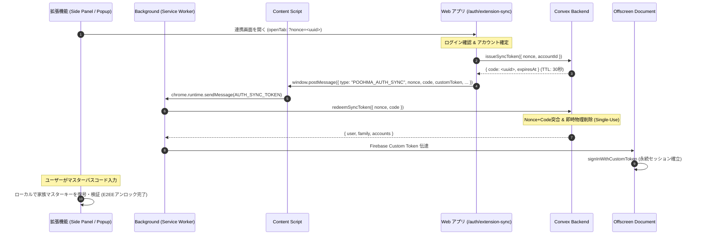

# ADR-009: Extension Authentication and Session Synchronization Strategy

## Status

Accepted（Issue #270: Chrome拡張機能連携における認証・セッション同期方式の選定）
※ Chrome Web Store 審査対応および関連パーミッション構成は**【暫定採用（Provisional）】**として位置付け、ストア審査時のフィードバック等に応じて柔軟に改訂可能とする。

## Context

PoohMa の Chrome 拡張機能（Manifest V3: Side Panel / Content Script / Background Service Worker / Offscreen Document）を提供するにあたり、Web アプリケーション（TanStack Start）および Convex バックエンドとの間で、どのように安全・シームレスにユーザーセッションと暗号化パラメータ（E2EE コンテキスト）を連携・確立するかが重要な設計課題となった。

### 解決すべき要件と制約条件

1. **Manifest V3 の制約**:
   - バックグラウンド実行環境が従来の Background Page から Service Worker に移行したことにより、DOM API や長時間の常駐接続、一部の IndexedDB 操作に制約がある。
   - 外部リモートスクリプトの実行禁止（CSP 厳格化）により、拡張機能内で動的に読み込む外部スクリプトや複雑なサードパーティ認証 UI の構築には保守コストとセキュリティリスクが伴う。
2. **ゼロ知識 E2EE アーキテクチャの厳格な維持（ADR-001）**:
   - マスターキー平文やマスターパスコードを安易に Web から拡張機能へ平文転送・ネットワーク露出してはならない。
   - 拡張機能側でも Web 側と同等の暗号学的独立性を担保し、ローカル復号・検証を行う必要がある。
3. **Single Source of Truth の原則**:
   - 認証の真実の源泉（Single Source of Truth）は Firebase Authentication（Google OAuth）であり、データアクセス認可の基盤は Convex Cloud のトークン検証機構である。
   - 拡張機能側で独自のアカウント・パスワード認証基盤を別建てすることは二重管理と不整合を招くため排除する。
4. **優れた UX とマルチアカウント（家族内サブアカウント）への対応**:
   - Web 側ですでにログイン済みのユーザーに対し、拡張機能側で再度ゼロからログイン手順（OAuth リダイレクトやメール認証）を強いる摩擦を排除し、1 クリックでセッションを引き継げること。
   - 家族内で複数アカウント（管理者アカウント、子アカウント等）を所有している場合、1 回の同期で全アカウント情報を安全に取得し、拡張機能内で切り替え可能であること。
5. **最小権限の原則（Least Privilege）とストア審査基準**:
   - Cookie やブラウザ全体の履歴を覗き見るような過剰な権限（`cookies` 権限など）を排除すること。

## Decision

以下のアーキテクチャを採用する：

### 1. Web アプリ連携ワンタイム Sync Token / Nonce ハンドシェイク方式の採用

拡張機能と Web アプリ間のセッション連携において、**「暗号学的 Nonce ＋ 短命ワンタイムコード（Sync Code）＋ 即時物理削除」**によるハンドシェイク方式を採用する。

- **短命 TTL とワンショット物理削除**: 同期コードの有効期限は 30 秒とし、`redeemSyncToken` 実行時にデータベースから即座に物理削除する。これにより、ブラウザ履歴の漏洩や中間者による再送攻撃（リプレイ攻撃）を完全に遮断する。
- **動的 Extension ID 制約と postMessage 採用根拠**: GitHub Releases から ZIP 配布（デベロッパーモードでのアンパックド読み込み）される環境では、Chrome 側で端末・プロファイルごとにランダムな Extension ID が動的に割り振られる。そのため、Web 側から固定 ID を宛先とする外部メッセージング（`chrome.runtime.sendMessage(EXTENSION_ID, ...)`）を行うことは不可能である。Web アプリケーション（同一オリジン検証済み）から Content Script への `window.postMessage`（暗号学的 Nonce ＋ ワンタイム短命コード）を経由する方式は、動的 Extension ID 制約下においてセッションを安全・確実に伝達する唯一かつ堅牢な設計である。
- **オリジン検証**: Web アプリから Content Script への伝達は `window.postMessage` を使用し、`event.origin !== window.location.origin` の厳格なチェックを行う。
- **マルチアカウント一覧の同時返却**: 同一の Firebase UID に紐づく全 `users` レコード（`accounts`）を返却することで、拡張機能側でのシームレスなアカウント切り替えを実現する。

### 2. E2EE 暗号化ヒント取得と閲覧監査ログ記録の設計原則

- **ゼロ知識暗号文と Query/Mutation 分離**:
  - `getRecords`（単発 HTTP クエリ）によって取得されるパスワードヒント（`passwordHint`、`passwordHintDekEncrypted` 等）は、すべてクライアントサイドで E2EE 暗号化された Blob（暗号文）であり、サーバー側では一切平文を解読できない。
  - レコード取得クエリ自体は安全な読み取り操作（Query）として扱い、ConvexHttpClient による単発取得とインメモリキャッシュによって拡張機能の動作を高速化・最適化する。
- **明示操作時の不可逆な閲覧監査ログ記録**:
  - 実際の閲覧監査ログ（`HINT_VIEW`）は、Side Panel 上でユーザーがマスターパスコードを入力して明示的に「表示」アイコンをクリックし、Web Crypto によるローカル復号が実行された瞬間（`decryptAndShowHint`）に Convex Mutation（`records:recordHintViewLog`）によって不可逆・確実に記録される。
  - これにより、ゼロ知識暗号アーキテクチャを損なうことなく、確実な監査証跡と高い応答性を両立している。

### 3. Offscreen Document による Firebase Auth 永続セッション管理と計算ワーカー化

Manifest V3 Service Worker の制約（DOM API 非対応、Web Crypto 実行等の分離）を補完し、Firebase Auth SDK の認証状態維持および Web Crypto 鍵導出の安全な計算処理を行うため、`chrome.offscreen` API を用いた **Offscreen Document（`entrypoints/offscreen/main.ts`）** を採用する。
- Web 側から渡された Firebase Custom Token を用いて、Offscreen Document 内の公式 Firebase Auth SDK で `signInWithCustomToken` を実行。
- これにより、公式のリフレッシュトークンサイクルが確立され、ID トークンの自動更新と Convex への安定したトークン供給が可能となる。
- Offscreen Document は `chrome.storage` に依存せず、Background Service Worker との `runtime.sendMessage` 通信による純粋な計算・認証ワーカーとして機能する。
- レコード一覧の取得は Background Service Worker が ConvexHttpClient による単発 HTTP クエリと 1 分間のインメモリキャッシュを用いて行い、WebSocket 常時購読による過剰な常駐リソース消費を防止する。

### 4. マスターパスコード（E2EE）の厳格な分離

- Web アプリから拡張機能へ、**平文のマスターパスコードや復号済みマスターキーは一切渡さない**。
- 拡張機能が受け取るのは、暗号化されたマスターキー（`masterKeyEncrypted`）、ソルト（`masterKeySalt`）、IV（`masterKeyIv`）、KDF反復回数（`kdfIterations`）のみとする。
- ユーザーは拡張機能の Side Panel 上で直接マスターパスコードを入力し、拡張機能ローカル（PBKDF2 + AES-GCM）で復号・検証を行う（ADR-001, ADR-002 準拠）。

---

## Chrome Web Store 審査に関する位置付け（暫定採用 / Provisional）

> [!IMPORTANT]
> **本節に記載の権限構成および認証連携設計は、現時点での【暫定採用（Provisional）】とする。**
> Chrome Web Store の公式審査ポリシー、事前審査の指摘事項、および審査チームからのフィードバックに基づき、必要に応じて柔軟に改訂・調整を行う前提とする。

### 現行設計における審査配慮と正当化理由（Justification）

1. **最小権限の追求**:
   - `chrome.cookies` 権限（Web のセッション Cookie を覗き見する権限）や不要な権限（`identity`, `scripting`）を一切要求せず、Web アプリ側が明示的にワンタイムコードを発行する設計とすることで、拡張機能の要求権限を最小化している。
2. **Offscreen Document の利用正当性**:
   - Manifest V3 で提供される `chrome.offscreen` API の正規理由（`reasons: ["DOM_SCRAPING", "BLOBS"]`）に準拠し、Firebase Auth SDK の永続認証状態維持および Web Crypto PBKDF2/AES 計算を目的として限定的に利用している。
3. **`<all_urls>`（host_permissions）の正当性**:
   - パスワードマネージャー / ヒント管理拡張機能として、ユーザーが訪問した任意の Web サイト上でログインフォームを検出し、パスワードヒントの参照・自動入力を支援するという「単一目的（Single Purpose）」のために不可欠な権限として申請する。

### 暫定扱いとする理由と将来の見直し方針

- **審査フィードバックに基づく調整可能性**:
  - Chrome Web Store の審査基準（特に外部サイト連携時の OAuth / 認証引き継ぎフローや Offscreen Document の理由付け審査）は、審査時期や担当者によって解釈の厳格さが変動しやすい。
  - 審査時に「`chrome.identity` API（`launchWebAuthFlow`）への統一」や「パーミッションの optional_permissions への細分化」などを要請された場合、本認証方式をベースとしつつ、ストア審査の要求水準に合わせた調整・リファクタリングを躊躇なく実施する。

---

## Alternatives（検討された代替案）

### 1. 拡張機能内での直接 Firebase Auth ログイン（Google / メール認証）
- **概要**: 拡張機能の Popup / Side Panel 内に Google ログインボタンやメールフォームを直接配置し、独立してログインさせる。
- **不採用理由**:
  - Manifest V3 の CSP 厳格化により、Google OAuth のポップアップやリダイレクトを拡張機能内で扱う実装が複雑化し、脆弱性や壊れやすさ（SDK 更新による非互換）のリスクが高い。
  - Web アプリですでにログインしているユーザーに対して、拡張機能でも再度 Google アカウント選択や 2 要素認証を強いることになり、UX 摩擦が極めて大きい。

### 2. `chrome.cookies` API による Cookie / ストレージ直接共有
- **概要**: 拡張機能に `cookies` 権限を付与し、`https://poohma.app` のセッション Cookie（`__session` 等）を直接読み取って認証を引き継ぐ。
- **不採用理由**:
  - `cookies` 権限はユーザーのブラウザプライバシーに関わる強力な権限であり、ストア審査でのハードルが高くなる。
  - セッション Cookie のみでは Firebase Auth の ID トークン自動リフレッシュや Convex 認証連携を直接ハンドリングできず、サーバー側での追加プロキシが必要になる。
  - 最小権限の原則（Least Privilege）に反する。

### 3. Chrome Identity API (`chrome.identity.launchWebAuthFlow`) による外部認可フロー
- **概要**: Chrome 公式の `identity.launchWebAuthFlow` を用いて、Web アプリの認可エンドポイントを別ウィンドウで開き、リダイレクト URL 経由でトークンを回収する。
- **保留 / 将来の代替候補**:
  - 標準的な OAuth PKCE パターンに近い堅牢な仕組みであるが、実装の複雑さと UI の遷移コスト（別ウィンドウポップアップ）が発生する。
  - 現行の「ワンタイム Sync Token / Nonce ハンドシェイク方式」でよりシンプルかつ安全に実現できているため現時点では見送った。ただし、Chrome Web Store 審査で強い要請があった場合の有力なフォールバック候補として維持する。

---

## Consequences

### メリット
- **優れた UX**: Web アプリでログイン済みのユーザーは、数秒でワンクリック認証連携が完了する。
- **高い安全性**: 30秒 TTL・Single-Use のワンタイムコードと Nonce により、コード漏洩やリプレイ攻撃の脅威を最小化。
- **E2EE 不変条件の死守**: マスターパスコードや平文マスターキーは一切ネットワークを通過せず、端末ローカルでのみ扱われる。
- **マルチアカウント対応**: 家族内のサブアカウント切り替えが追加認証なしでシームレスに行える。

### デメリット / 残存課題
- 初回連携時に Web アプリケーションを開く必要がある。
- Offscreen Document の常駐により、わずかなメモリオーバーヘッドが存在する。
- Chrome Web Store 審査の動向次第で、パーミッションや通信フローの微調整が必要になる可能性がある（暫定位置付けによるリスク管理）。

---

## 関連ドキュメント

- [ADR-001: E2EE Architecture](./001-e2ee.md)
- [ADR-002: Key Management](./002-key-management.md)
- [ADR-004: Family Authorization](./004-family-authorization.md)
- [E2EE Design](../security/e2ee.md)
- [Security Model](../security/security-model.md)
- [Code Design](../code-design.md)
- [.ai/invariants.md](../../.ai/invariants.md)
- [.ai/pitfalls/crypto-e2ee.md](../../.ai/pitfalls/crypto-e2ee.md)
- [.ai/pitfalls/review-and-guardrails.md](../../.ai/pitfalls/review-and-guardrails.md)
